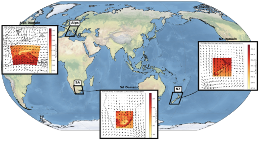

# CORDEX ML-Bench: A benchmark for Machine Learning-Based Regional Climate Downscaling

<!-- --8<-- [start:home1] -->

CORDEX ML-Bench is a benchmark designed to evaluate the performance of machine learning–based climate downscaling models across different regions covering both the standard (perfect prognosis ESD) and emulation climate downscaling approaches. It defines standardized training and test experiments assessing various downscaling challenges along with the corresponding datasets from Regional Climate Models (RCMs) driven by different Global Climate Models (GCMs). 

This repository contains all the materials, instructions, and datasets required to run the different experiments, as well as notebooks illustrating the process. It also includes instructions for registering and submitting contributions to participate in the online benchmarking, with results publicly reported on this page.

**Development Status Notice**  
*This repository is currently under active development. As a result, the structure, documentation, datasets and experimental protocols may change in the near future. Users should be aware that updates may require adjustments to existing workflows. We recommend regularly checking for updates.*

<!-- --8<-- [end:home1] -->

<!-- --8<-- [start:intro] -->

## Dataset Overview

The benchmark covers three geographic regions: New Zealand (NZ), Europe (ALPS) and South Africa (SA) with ~10km target resolution. Training and test datasets (NetCDF files, approximately 5 GB per domain) are provided for each region, including common predictors (Z, U, V, T, Q at 850, 700, 500, and 300 hPa, as well as model orography) and predictands (daily temperature and precipitation). More information in [./data](/data)

<div align="center">

</div>

## Experiments

The benchmark covers two experiments with different tests focusing on the standard (perfect prognosis ESD) and emulation climate downscaling approaches. For each region, data is obtained from a single RCM driven by two different GCMs, one used both for training and testing (denoted below as `same GCM`) and the other only used to test transferability (denoted as `different GCM`).

For both experiments, training is based on perfect (upscaled) predictors from the RCM while test experiments explore both perfect and imperfect (from the driving GCM) predictors. Predictands (target for training) correspond to the RCM highres 10km temperature and precipitation output.

### ESD Pseudo-Reality

A 20-year (1961–1980) training period in present climate conditions, designed to mimic the standard statistical climate downscaling approach and test extrapolation capabilities of the methods.

| Test   | Test Period | Predictor type | Eval |
|----------------|---------------|----------------|------|
| Test1: Perfect Cross-Validation | Historical (1981–2000) | Perfect (from RCM), same GCM | Error, Clim |
| Test2: Imperfect Cross-Validation | Historical (1981–2000) | Imperfect (from GCM), same GCM | Error, Clim |
| Test3: Perfect Extrapolation | 2041–2060 + 2080–2099 | Perfect (from RCM), same GCM | change signal for mid/final term |
| Test4: Imperfect Extrapolation | 2041–2060 + 2080–2099 | Imperfect (from GCM), same GCM | change signal for mid/final term |
| Test5: Perfect Extrapolation (GCM Transferability) | 2041–2060 + 2080–2099 | Perfect (from RCM), different GCM | change signal for mid/final term |


### Emulator Hist+Future

A 40-year (1961–1980 + 2080–2099) training period combining present and future climates, focused on testing interpolation and transferability of emulators.

| Test   | Test Period | Predictor type | Eval |
|----------------|---------------|----------------|------|
| Test1: Perfect Cross-Validation | Historical (1981–2000) | Perfect (from RCM), same GCM | Error, Clim |
| Test2: Imperfect Cross-Validation | Historical (1981–2000) | Imperfect (from GCM), same GCM | Error, Clim |
| Test3: Perfect Interpolation  | 2041–2060  | Perfect (from RCM), same GCM | Change signal |
| Test4: Imperfect Interpolation | 2041–2060  | Imperfect (from GCM), same GCM | Change signal |
| Test5: Perfect Interpolation (GCM Transferability) | 2041–2060  | Perfect (from RCM), different GCM | Change signal |
| Test6: Imperfect Interpolation (GCM Transferability) | 2041–2060  | Imperfect (from GCM), different GCM | Change signal |

## Model Training and Evaluation

For each experiment, models must be trained for the two required target variables (temperature and precipitation), jointly (multivariate) or individually. If possible, please train the models both with and without model orography as a covariate (this will correspond to two separate submissions; for more details, see [Submit your model](contributing/submission.md)). This will allow us to assess the importance of including such covariates in the models. Some examples of model training can be found in [Train your model](contributing/training.md).

A comprehensive set of evaluation diagnostics and accompanying code for assessing ML-based downscaling methods within the CORDEX ML-Bench framework is provided in this repository (see [Evaluate your model](contributing/evaluation.md)). Similar diagnostics will be used for online benchmarking, so users can use these as guidelines for developing their models.

## Requirements

The scripts in this repository, including the evaluation with [`ml-evaluation`](https://github.com/c3s-cordex-ml/ml-evaluation), run in a Python environment that can be created in two ways.

**Option 1: Pixi.** [Pixi](https://pixi.sh) creates the environment inside the repository (in `.pixi/`) from `pixi.toml`, with the exact versions pinned in `pixi.lock`. Install Pixi once (on Windows, see the [installation guide](https://pixi.sh/latest/installation/)), then create the environment from the root of the repository:

```bash
curl -fsSL https://pixi.sh/install.sh | sh   # install Pixi (Linux/macOS), only once
pixi install                                 # create the environment
```

Commands are then run with `pixi run`, e.g. `pixi run evaluate-model ...` (see [Evaluate your model](contributing/evaluation.md)).

**Option 2: Conda.** The [requirements](https://github.com/casadoj/ml-benchmark/tree/main/requirements) directory contains an `environment.yaml` file to create the Conda environment `ml-benchmark`:

```bash
conda env create -f requirements/environment.yaml
conda activate ml-benchmark
```

<!-- --8<-- [end:intro] -->

## Contributing to the benchmark

<!-- --8<-- [start:contributing] -->

Benchmarking allows users to benchmark the performance of their own models against well-established reference approaches. Contributing to the online benchmarking (with automatic evaluation and publicly available results in the benchmark table) requires model registration and uploading the test results for the different experiments. For more details on the registration and submission process, see [Submission](docs/contributing/submission.md).

<!-- --8<-- [end:contributing] -->

## Results

- [Models contributing to the benchmark](docs/results/models.md): a table that summarizes the contributing models and provides links to their respective implementation repositories when available.
- [Scoreboards](docs/results/scoreboard/index.md): performance of the submitted models, one page per training experiment ([ESD pseudo-reality](docs/results/scoreboard/esd_pseudo_reality.md), [Emulator hist+future](docs/results/scoreboard/emulator_hist_future.md)).

<!-- --8<-- [start:home2] -->

## Citation


> Rampal, N., González-Abad, J., Addison, H., Baño-Medina, J., Bettolli, M. L., Blasone, V., Booth, B., Coppola, E., Di Gioia, S., Oldham-Dorrington, J., Doury, A., Engelbrecht, F., Fuentes-Franco, R., Gibson, P. B., Glawion, L., Hardy, C., Ivanov, M., Lee, H. K., Legasa, M. N., Olmo, M., Orr, A., Polz, J., Rogers, M. S. J., Schillinger, M., Sharma, S., Soares, P. M. M., Sobolowski, S., Steinkopf, J., Tang, W., Tian, J.-B., Tomé, R., Wang, K.-C., Wang, Y.-C., Watson, P. A. G., Wetherell, T., Widmann, M., & Gutiérrez, J. M. (2026). *CORDEX-ML-Bench: A Benchmark for Data-Driven Regional Climate Downscaling — Experiment Design and Overview*. arXiv:2606.29172. https://arxiv.org/abs/2606.29172

## Contact

Open an [issue](https://github.com/casadoj/ml-benchmark/issues) in this repository.

<!-- --8<-- [end:home2] -->
