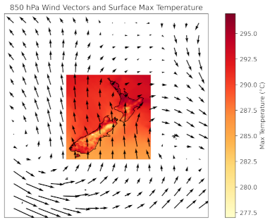
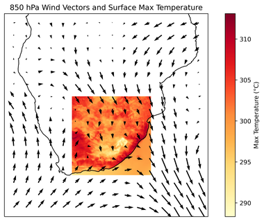
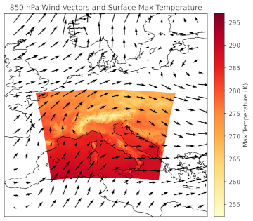

# Dataset Overview

The CORDEX ML-Bench dataset is publicly available at [Zenodo](https://zenodo.org/records/20985924) as a `zip` file per domain, containing all the NetCDF files for the different experiments. The data is around 5 GB per domain.

The notebook [`data_download.ipynb`](https://github.com/WCRP-CORDEX/ml-benchmark/blob/main/data/data_download.ipynb) explains how to download the data for the different domains, and the notebook [`experiments.ipynb`](https://github.com/WCRP-CORDEX/ml-benchmark/blob/main/data/experiments.ipynb) provides a walkthrough of the downloaded data, helping users understand the data and how to configure the train and test datasets for the different experiments forming the benchmark. We encourage users to carefully review this notebook to become familiar with the data.

The dataset spans three geographic regions, each defined over domains of identical size (i.e., the same number of grid boxes). For each domain, the dataset comprises data derived from a single Regional Climate Model (RCM) driven by two different Global Climate Models (GCMs). The first GCM is used for both training and testing, while the other is used exclusively for testing transferability. 

## Domains

### New Zealand (NZ)

- Resolution: 0.11°
- RCM: _CCAM-2203_ (from [CORDEX-CMIP6](https://wcrp-cordex.github.io/simulation-status/CORDEX_CMIP6_status.html#AUS-12))
- Driving GCM 1 (training and test): _ACCESS-CM2_r4i1p1f1 (historical and SSP3-7.0 scenarios)_
- Driving GCM 2 (test transferability): _EC-Earth3_r1i1p1f1 (historical and SSP3-7.0 scenarios)_

For this domain, both predictors and predictands have been interpolated to regular lon/lat grids.

<div align="center" markdown>

</div>

### South Africa (SA)

- Resolution: 0.10°
- RCM: _CCAM-2203_ <br>
- Driving GCM 1 (training and test): _ACCESS-CM2 (historical and SSP3-7.0 scenarios)_
- Driving GCM 2 (test transferability): _NorESM2-MM (historical and SSP3-7.0 scenarios)_

For this domain, both predictors and predictands have been interpolated to regular lon/lat grids.

<div align="center" markdown>

</div>

### Europe (ALPS)

- Resolution: 0.11°
- RCM: _Aladin63_ (from CORDEX-CMIP5)
- Driving GCM 1 (training and test): _CNRM-CM5 (historical and rcp85 scenarios)_
- Driving GCM 2 (test transferability): _MPI-ESM-LR (historical and rcp85 scenarios)_

For this domain, both predictors and predictands are provided on the _Lambert Conformal Conic_ projection as simulated by the Aladin63 RCM. This is transparent for the benchmark since the data is provided over the same 16x16 and 128x128 squared grids and can be used directly for model training without reprojection as in the other cases (see [./data](/data) for more details). When plotted on a regular lat–lon grid the domain appears curved (see the image below), but in its native projection the data lies on a square array (the `x` and `y` coordinates in the files represent the regular coordinates, whereas the `lat` and `lon` coordinates denote the corresponding geographical latitude and longitude values, which are automatically used by standard plotting functions). <br>

<div align="center" markdown>

</div>

## Predictors and Predictands

The `training` dataset provides the information from the RCM needed to train the models, both the predictors and the predictands. 

**Predictors** include coarse large-scale (~200 km), daily information for a set of common atmospheric variables ($Z$, $U$, $V$, $T$, $Q$ at different height levels 850, 700, and 500 $hPa$) characterizing the 3D atmospheric state and are provided over a large squared domain (16x16) represented in the figures above displaying the wind fields ($U$, $V$).

> $Z$: geopotential [$m^2\,s^{-2}$]<br>$U$: zonal wind speed [$m\,s^{-1}$]<br>$V$: meridional wind speed [$m\, s^{-1}$]<br>$T$: temperature [$K$]<br>$Q$: specific humidity [$kg\,kg^{-1}$]

**Predictands** correspond to the RCM high-resolution (~10 km), daily maximum temperature and precipitation output over an inner square domain (128x128) represented in the figures below with the temperature fields. High-resolution model orography (~10 km) is also provided in the dataset and can be used as a covariate in the models. 

> $tasmax$: maximum temperature [$K$]<br>$pr$: accumulated precipitation [$mm$ (ALPS, NZ); $kg\,m^{-2}\,s^{-1}$ (SA)]

This training data is provided for the two benchmark experiments focusing on the standard (ESD) and emulation downscaling approaches, denoted as `ESD Pseudo-Reality` and `Emulator Hist+Future`. Models should be trained separately on both experiments.

`Test` data includes both `perfect` (upscaled from the RCM, as in the training data) and `imperfect` (from the driving GCM) predictors over the same 16x16 domains.

## Data Structure

Each domain follows a consistent file structure, with the same subdirectories for training and testing data. Predictors and predictands are labelled with the names of the driving GCMs; note that all runs within a domain use the same RCM. The scheme below illustrates this for the New Zealand (NZ) domain.

```
NZ_domain/
├── train/
│   ├── ESD_pseudo-reality/
│   │   ├── predictors/
│   │   │   ├── ACCESS-CM2_1961-1980.nc
│   │   │   └── Static_fields.nc
│   │   └── target/
│   │   │   └── pr_tasmax_ACCESS-CM2_1961-1980.nc
│   ├── Emulator_hist_future/
│   │   ├── predictors/
│   │   │   ├── ACCESS-CM2_1961-1980_2080-2099.nc
│   │   │   └── Static_fields.nc
│   │   └── target/
│   │   │   └── pr_tasmax_ACCESS-CM2_1961-1980_2080-2099.nc
└── test/
    ├── historical/
    │   ├── predictors/
    │   │   ├── perfect/
    │   │   │   ├── ACCESS-CM2_1981-2000.nc
    │   │   │   └── EC-Earth3_1981-2000.nc
    │   │   └── imperfect/
    │   │       ├── ACCESS-CM2_1981-2000.nc
    │   │       └── EC-Earth3_1981-2000.nc
    ├── mid_century/
    │   ├── predictors/
    │   │   ├── perfect/
    │   │   └── imperfect/
    └── end_century/
        └── predictors/
            ├── perfect/
            └── imperfect/
```
