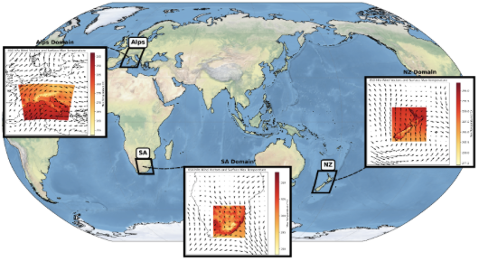

# Introduction

## Dataset Overview

--8<-- "README.md:dataset"

<div align="center" markdown>
{ width="500" }
</div>

## Experiments

--8<-- "README.md:experiments"

## Model Training and Evaluation

--8<-- "README.md:train_eval"

## Requirements

The scripts in this repository, including the evaluation with [`ml-evaluation`](https://github.com/c3s-cordex-ml/ml-evaluation), run in a Python environment that can be created in two ways.

**Option 1: Pixi.** [Pixi](https://pixi.sh) creates the environment inside the repository (in `.pixi/`) from `pixi.toml`, with the exact versions pinned in `pixi.lock`. Install Pixi once (on Windows, see the [installation guide](https://pixi.sh/latest/installation/)), then create the environment from the root of the repository:

```bash
curl -fsSL https://pixi.sh/install.sh | sh   # install Pixi (Linux/macOS), only once
pixi install                                 # create the environment
```

Commands are then run with `pixi run`, e.g. `pixi run evaluate-model ...` (see [Evaluate your model](contributing/evaluation.md)).

**Option 2: Conda.** The [requirements](https://github.com/casadoj/ml-benchmark/tree/main/requirements) directory contains an `environment.yaml` file to create the Conda environment `ml-benchmark`:

```bash
conda env create -f requirements/environment.yaml
conda activate ml-benchmark
```

## Citation

--8<-- "README.md:citation"

## Contact

Open an [issue](https://github.com/casadoj/ml-benchmark/issues) in this repository.
